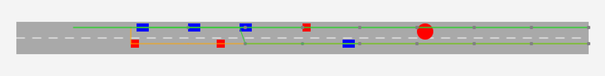
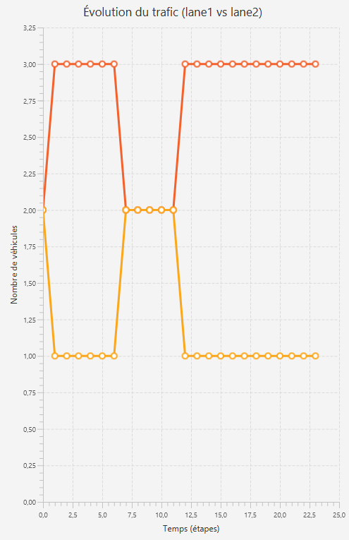
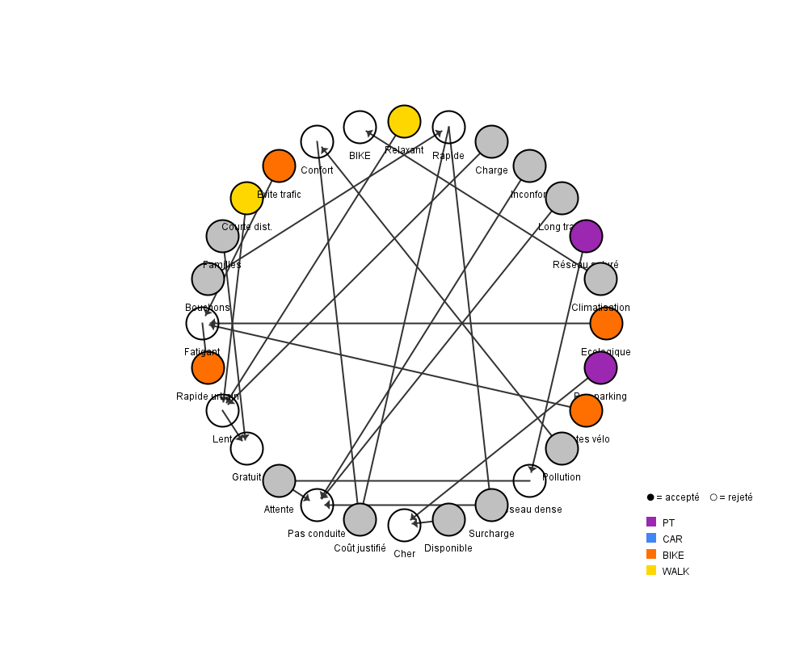
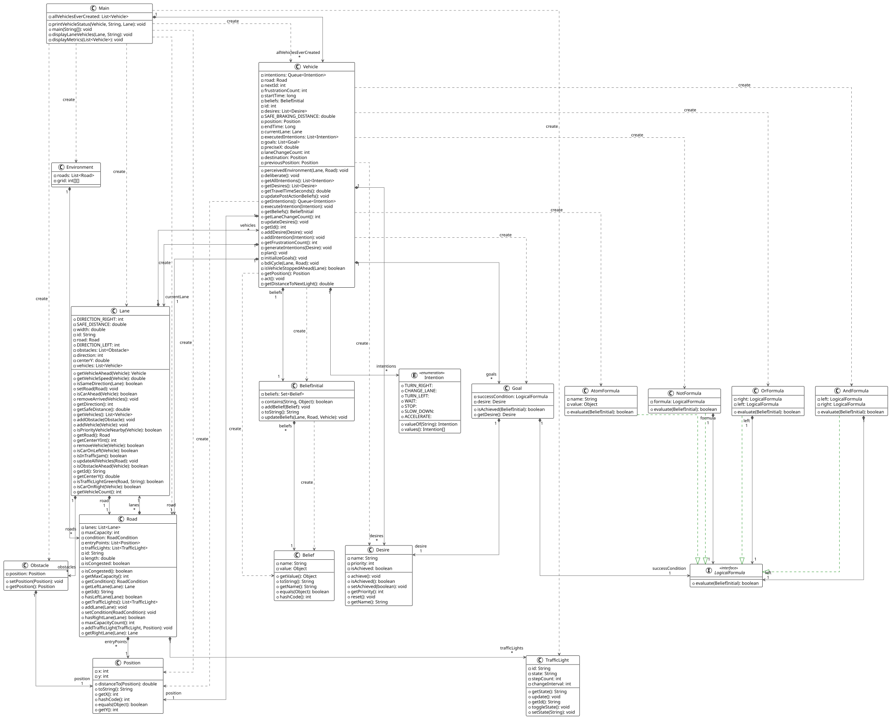

# Multi-agent traffic simulation: BDI vehicles, MDP traffic lights, argumentation

A Java traffic simulator (about 3,400 lines) where three decision techniques work together:

- **Vehicles are BDI agents.** Each vehicle runs a belief–desire–intention cycle: it perceives
  lights, obstacles and neighbouring vehicles (beliefs), weighs goals such as reaching its
  destination or avoiding a collision (desires), and commits to actions: accelerate, brake,
  change lane, stop (intentions). Conditions are written as logical formulas evaluated by an
  interpreter (`AtomFormula`, `AndFormula`, `OrFormula`, `NotFormula`).
- **Traffic lights are controlled by a Markov decision process.** The state is the light colour
  × the traffic level (none, medium, heavy); traffic evolves through a Markov transition matrix.
  The policy is solved by value iteration (γ = 0.8) and refined online with a Q-learning update.
- **Each traveller chooses a transport mode by argumentation.** Arguments for and against car,
  public transport, walking and cycling (weather, health, rush hour) form a Dung argumentation
  framework, solved with the TweetyProject library under grounded, preferred, complete and
  stable semantics, alongside a score-based decision.
- **Routes are planned with Dijkstra** on the road graph.

A JavaFX interface animates the scenarios: a two-lane road with a light, intersections,
obstacles, free-flow and congested traffic. Each vehicle records its travel time, lane changes
and frustration (time blocked).

## Preview

**The simulation.** Vehicles (blue) drive towards a traffic light (the red disc) on a two-lane
road with obstacles (red squares). Orange lines are the routes planned with Dijkstra, including
the lane changes that avoid the obstacles; green segments point to each vehicle's next waypoint.



<table>
<tr>
<td width="38%"></td>
<td></td>
</tr>
<tr>
<td><b>Vehicles on each lane over time</b>, updated live in the interface: each lane change shows
as the two curves moving in opposite directions.</td>
<td><b>Choice of transport mode by argumentation.</b> Each node is an argument for a mode
(public transport, car, bike, walking) or against it; arrows are attacks. Filled nodes are
accepted under the chosen semantics, empty ones are defeated.</td>
</tr>
</table>

## Architecture



| Package | Content |
|---|---|
| `agent` | `Vehicle` (BDI cycle), `BeliefInitial`, `Desire`, `Intention`, `Goal` |
| `logic` | Interpreter for logical formulas used in beliefs and plans |
| `environment` | `Road`, `Lane`, `TrafficLight` (MDP), `TransitionMatrix`, `IntersectionController`, `Obstacle` |
| `planning` | Road graph and Dijkstra |
| `ArgumentationDM` | `TransportationAgent` (Dung framework, TweetyProject), `DungGraphPanel` (graph view) |
| `gui` | `TrafficSimulatorApp` (JavaFX) |

## Run

Requirements: Java 21, JavaFX 24 and the TweetyProject jars in `lib/` (see `run.bat`).

```bash
run.bat                                   # compiles and launches the JavaFX simulator
```

`Main.java` runs the console scenarios (`runScenario1` to `runScenario4`) and a batch of 100
transport-mode decisions.

The design, UML diagrams and experiments are described in the course report (French):
[`MARIUS_CASAMIAN_cm22205773_planifReport.pdf`](MARIUS_CASAMIAN_cm22205773_planifReport.pdf).
